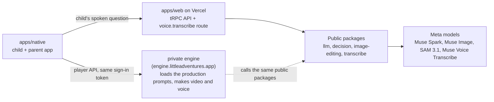

# Architecture

A short map for hackathon judges and their agents: what is in this repo, which Meta model runs where, what is private and why, and what you can run without the private part.

## The split

The app talks to the app server and, when an engine URL is set, to the private engine through a documented player API with the same sign-in token. Every Meta model call goes through a public package in this repo.

## What is public

All of it was written this week, during the hackathon (Oct 27 to Nov 4, 2026).

| Package | Meta model | What it does |
| --- | --- | --- |
| `packages/llm` | Muse Spark | Structured-output client. The caller passes instructions, a prompt and a zod schema, and gets validated JSON back. |
| `packages/decision` | Muse Spark | Decision API. Asks a set of yes or no questions about a state (and optional images), applies a pass threshold, and follows a policy for when the API cannot be reached. |
| `packages/image-editing` | SAM 3.1, Muse Image | SAM 3.1 cuts the person out of a photo. Muse Image applies looks, edits with several references, and generates images. |
| `packages/transcribe` | Muse Voice Transcribe | Turns the child's spoken question (WAV, 16 kHz, mono) into text, on the app server's `voice.transcribe` route. |

The apps (`apps/native`, `apps/web`) and the other packages (`api`, `auth`, `db`, `storage`, `validation`, `ui`, `native-ui`, `config`) are public too.

## What is private, and why

The packages hold no production prompts and no question sets. They refuse to run without instructions from the caller and point to the "Prompts" section of the [README](README.md). Those prompts, plus the video and voice production, live in a private engine at engine.littleadventures.app.

Why private:

- The media production rests on know-how that existed before this hackathon. It is the team's trade secret.
- The production prompts and question sets were written this week, and are kept private so the shape of the product's output cannot be copied. The code that calls Meta's models with them is the public packages above.
- The organizers allowed keeping a pre-existing platform private as a hosted service, with a note in the README (Kai, Cerebral Valley, 2026-10-26: [message in the hackathon Discord](https://discord.com/channels/1557169028080869426/1564256986848043148/1564310060702896240)).

This repo does not describe how the engine works inside. It documents only what crosses the boundary: the player API the app calls.

## What you see without the engine

Leave `EXPO_PUBLIC_ENGINE_URL` unset and the app plays its bundled sample adventure. No engine, no extra accounts: you can run the app alone.

With an engine URL set, allowlisted accounts get live adventures. Every other account gets a recorded adventure.

An adventure is a fixed map: an intro, 4 places that each teach one fact, and a goodnight that opens after all 4 places.

## Built this week, and what existed before

| Built this week, public (this repo) | Built this week, private | Existed before the hackathon, private |
| --- | --- | --- |
| The app, the app server and every public package above | The production prompts and question sets | The media production know-how |
| Every call to a Meta model | The private engine that runs them and serves video and voice | |
| The player API client in the app | | |

The commit history of this repo, started Oct 30, 2026, is the record of the public work.
