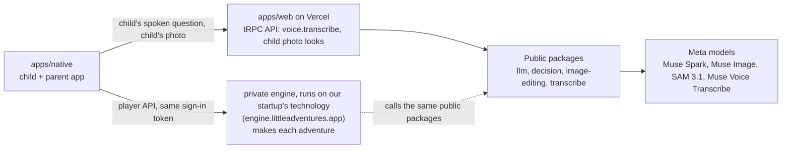
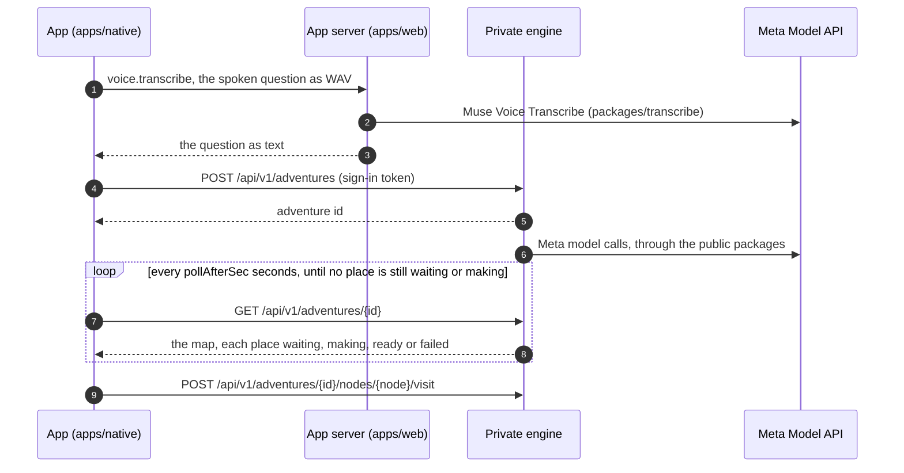
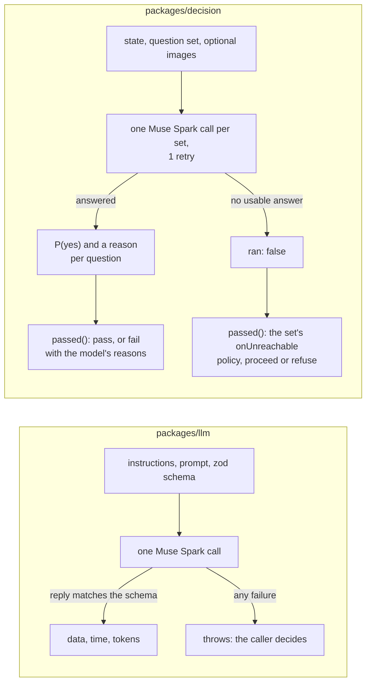

# Architecture

A short map for hackathon judges and their agents: what is in this repo, which Meta model runs where, how a question becomes an adventure, how the public `llm` and `decision` packages work, what is private and why, and what you can run without the private part.

> **The private engine runs on our startup's proprietary technology, built before the hackathon. That technology uses Meta's models: every Meta model call it makes goes through the public packages in this repo. How it uses them is the part we cannot disclose during the hackathon.**

## The split



The app talks to the app server and, when an engine URL is set, to the private engine through its player API with the same sign-in token (every call is in `apps/native/src/data/engine-client.ts`). Every Meta model call goes through a public package in this repo. On the app server, SAM 3.1 and Muse Image turn the child's photo into the look avatars (`packages/api/src/art.ts`).

## How a question becomes an adventure



- Each ready place carries its picture, clip and narration.
- The goodnight scene stays locked until all 4 places are visited.
- The app waits at most 6 minutes, and gives up after 4 failed reads in a row. Then it shows a calm error screen.
- With an engine URL set, accounts on the live allowlist get a live adventure. Every other account gets a recorded adventure.
- The player API client is `apps/native/src/data/engine-client.ts`, and the mapping to screens is `engine-map.ts` beside it.

## The `llm` and `decision` packages

Both packages are prompt-free clients for Muse Spark on Meta's Model API. The caller brings its own instructions, gets validated results back, and decides what to do with them.



What the caller passes: the key, the model name, its instructions, a zod schema or a question set, and a `safetyId` (an opaque, stable id of the grown-up, never an email). The packages return the validated result, the time taken and the tokens used, so the caller can record the cost of every call.

### `packages/llm`: structured output

- One `POST https://api.meta.ai/v1/chat/completions` per call. The caller's instructions and prompt are the two messages. `response_format` is a strict JSON schema made from the caller's zod schema, and `safety_identifier` carries the `safetyId`.
- Returns `{ data, model, ms, usage }`. `data` has been parsed by the zod schema.
- No retries, because a retry is billed again. It throws on missing instructions (before any request), a missing key, a non-2xx reply, an empty reply, or a reply that does not match the schema. The caller decides what a throw means.

### `packages/decision`: the decision API

- A question set has a name, its questions (each with its own instructions), and an `onUnreachable` policy: `proceed` or `refuse`.
- All questions in a set go in one request. The reply is strict JSON with `{ answer, confidence, reason }` for each question. Images can be attached.
- Each answer becomes P(yes): the confidence for a yes, 1 minus the confidence for a no. A question passes at P(yes) of at least 0.5 (`passAt`). A risk question marked `passWhen: "no"` passes below it.
- `decide` never throws. A missing key returns `ran: false` at once, with no request. A timeout (60 s), a non-2xx reply or a malformed verdict gets one retry, then returns `ran: false`. `passed()` then applies the set's `onUnreachable` policy. When the model did run, it returns the model's reason for each failed question.

| When a call fails | `llm` | `decision` |
| --- | --- | --- |
| Retries | none | 1 |
| Result | throws | `ran: false` |
| Who decides what happens | the caller | the question set's `onUnreachable` policy |

### Using them

```ts
import { createDecision, type QuestionSet } from "@little-adventures/decision";
import { createLlm } from "@little-adventures/llm";
import { z } from "zod";

const apiKey = process.env.META_API_KEY ?? "";
const model = "muse-spark-1.3";
const safetyId = "grown-up-123";

const llm = createLlm({ apiKey, model });
const out = await llm.generate({
  instructions: "<your instructions>",
  prompt: "<your prompt>",
  safetyId,
  schema: z.object({ answer: z.string() }),
});

const decision = createDecision({ apiKey, instructions: "<your instructions>", model });
const check: QuestionSet = {
  name: "example",
  onUnreachable: "refuse",
  questions: {
    q1: { instructions: "<a yes or no question>" },
    q2: { instructions: "<a risk question>", passWhen: "no" },
  },
};
const verdict = await decision.decide({ result: out.data }, check, { safetyId });
const { passed, reasons } = decision.passed(verdict, check);
```

The unit tests cover the main failure paths (missing instructions, a non-2xx reply, a reply that does not match the schema, an unreachable API under each policy): `packages/llm/src/llm.test.ts` and `packages/decision/src/decision.test.ts` (`bun test` in each package).

## What is public

All of it was written this week, during the hackathon (Oct 27 to Nov 4, 2026).

| Package | Meta model | What it does |
| --- | --- | --- |
| `packages/llm` | Muse Spark | Structured-output client. The caller passes instructions, a prompt and a zod schema, and gets validated JSON back. |
| `packages/decision` | Muse Spark | Decision API. Asks a set of yes or no questions about a state (and optional images), applies a pass threshold, and follows a policy for when the API cannot be reached. |
| `packages/image-editing` | SAM 3.1, Muse Image | SAM 3.1 cuts the person out of a photo. Muse Image applies looks, edits and generates images. |
| `packages/transcribe` | Muse Voice Transcribe | Turns the child's spoken question (WAV, 16 kHz, mono) into text, on the app server's `voice.transcribe` route. |

The apps (`apps/native`, `apps/web`) and the other packages (`api`, `auth`, `db`, `storage`, `validation`, `ui`, `native-ui`, `config`) are public too.

## What is private, and why

`llm` and `decision` hold no production prompts and no question sets: they refuse to run without instructions from the caller and point to the "Prompts" section of the [README](README.md). The only prompts in this repo are the avatar look prompts in `packages/image-editing/src/looks.ts`, which the app server sends to Muse Image. The production prompts and question sets, plus the video and voice production, live in a private engine at engine.littleadventures.app, which runs on our startup's proprietary technology. It calls Meta's models through the public packages above.

Why private:

- The engine runs on our startup's proprietary technology, which existed before this hackathon. That technology uses Meta's models through the public packages in this repo; how it uses them is the team's trade secret, which we cannot disclose during the hackathon.
- The production prompts and question sets were written this week, and are kept private so the shape of the product's output cannot be copied. The code that calls Meta's models with them is the public packages above.
- The organizers allowed keeping a pre-existing platform private as a hosted service, with a note in the README (Kai, Cerebral Valley, 2026-10-26: [message in the hackathon Discord](https://discord.com/channels/1557169028080869426/1564256986848043148/1564310060702896240)).

This repo does not describe how the engine works inside. It documents only what crosses the boundary: the player API the app calls, and the interface of the public packages.

## What you see without the engine

Leave `EXPO_PUBLIC_ENGINE_URL` unset and the app plays its bundled sample adventure. No engine is needed. Sign-in and the child's profile still go through the app server (`apps/web`), which needs the auth and database values in `apps/web/.env.schema`.

With an engine URL set, allowlisted accounts get live adventures. Every other account gets a recorded adventure.

An adventure is a fixed map: an intro, 4 places that each teach one fact, and a goodnight that opens after all 4 places.

## Built this week, and what existed before

| Built this week, public (this repo) | Built this week, private | Our startup's proprietary technology (before the hackathon, private) |
| --- | --- | --- |
| The app, the app server and every public package above | The production prompts and question sets | The video and voice production the engine runs on |
| Every call to a Meta model | | |
| The player API client in the app | | |

The commit history of this repo, started Oct 30, 2026, is the record of the public work.
