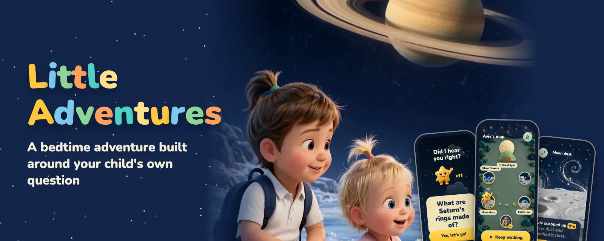
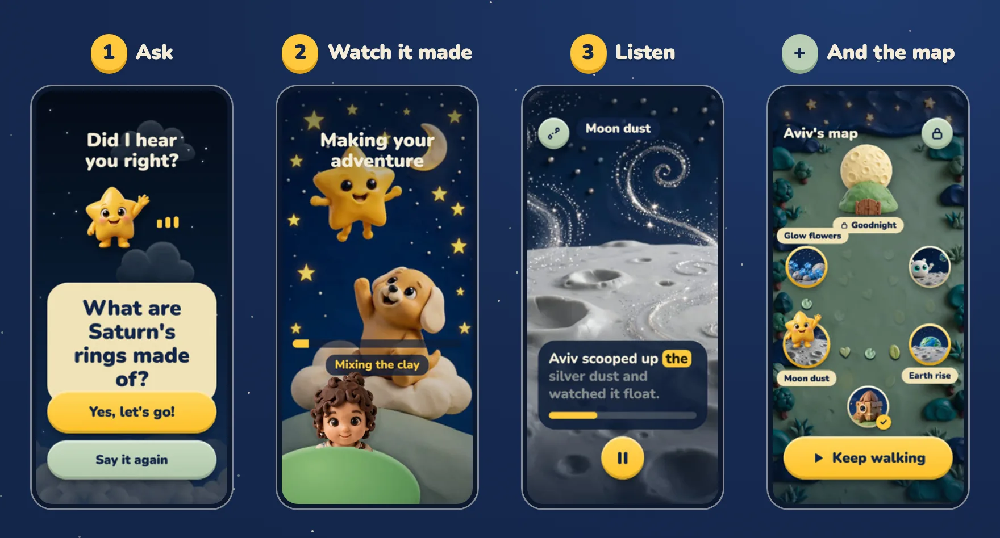
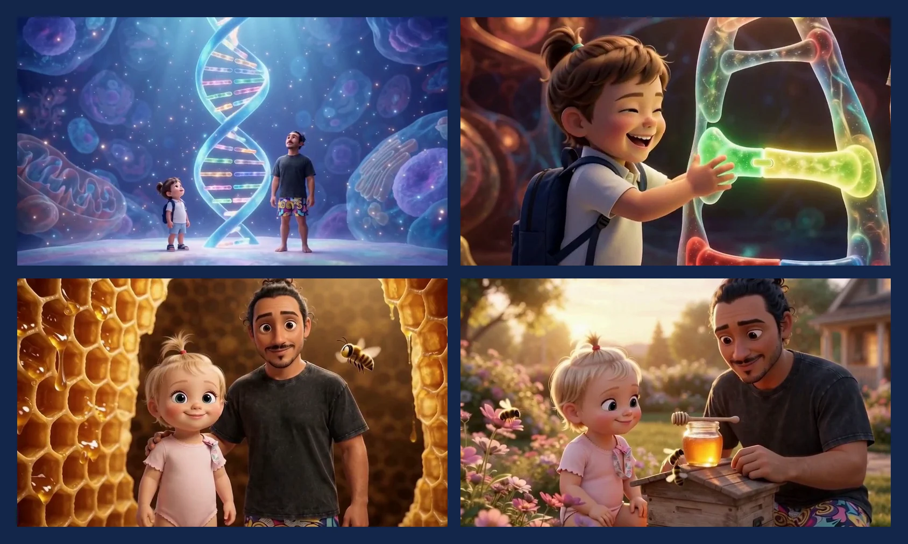
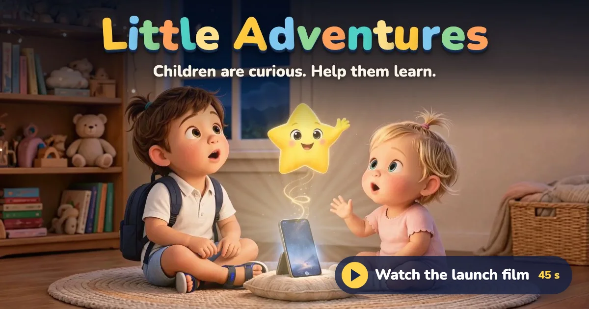
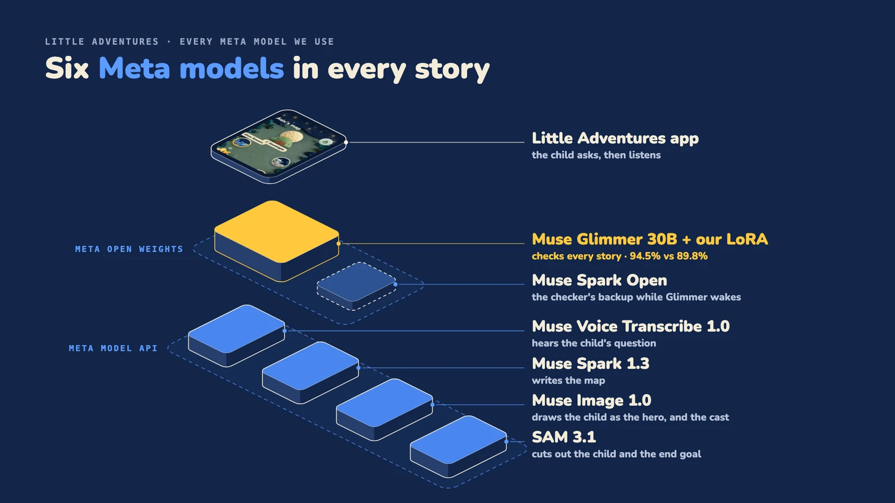
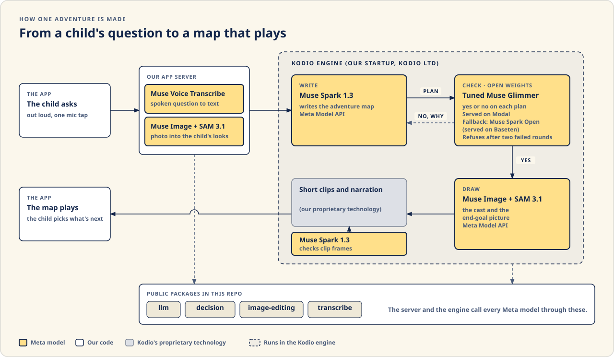
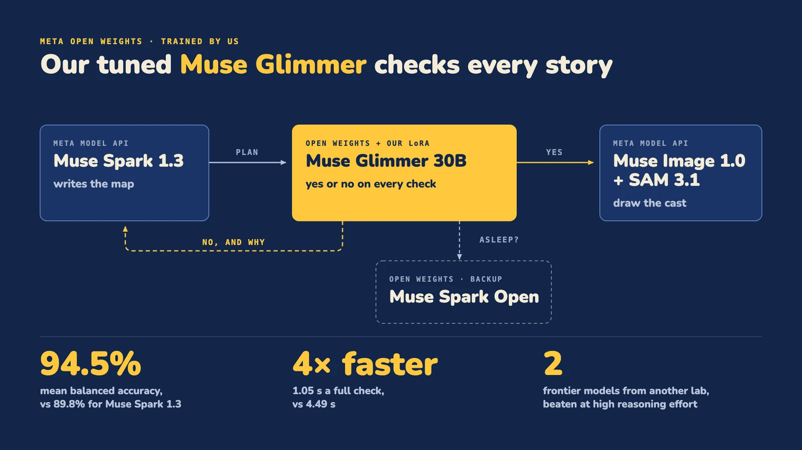

# Little Adventures

<p align="center"></p>

A story app for children aged 2 to 16 that doubles as a learning platform. The child asks a question out loud ("can we fly to the moon?"), and the story is built around it: narrated, illustrated chapters that star the child's own character. At the end of each chapter the child picks what happens next, so the story follows their curiosity and teaches something real along the way. A parent sits beside them and sets things up in the app. Built by Pavel Kaminsky at Kodio Ltd, a parent of two, because the best questions come at bedtime.

- **One spoken question, no typing.** Muse Voice Transcribe hears the child.
- **The child is the hero.** One photo becomes the child's own drawn look, and that look stars in every story (SAM 3.1 and Muse Image).
- **The wait is part of the story.** The star and the puppy make the adventure on screen while the child watches.
- **The child picks the next place.** A map of four places, each with one true fact that answers the question.
- **English, Spanish and Hebrew, and on the TV.** The grown-up picks the language, and a story can be cast to the TV from iPhone or Android.
- **Every plan is checked before a child hears it.** Our tuned Muse Glimmer answers yes or no, and a failed check goes back with a reason.

[](https://www.youtube.com/watch?v=ofxkeGxQeOU) [](https://x.com/KaminskyPavel/status/2117210112993755191) [](https://huggingface.co/kaminskypavel/glimmer-decision-little-adventures)

> **Meta Global AI Developer Hackathon 2026** · Startup track (Kodio Ltd) · Build for Your World
>
> Started on Oct 30, 2026, inside the building period, and all written then. The clips and narration come from Kodio's engine, which existed before: [what is new and what is not](documents/architecture.md).
>
> Pre-existing dependency: the Kodio engine, Kodio Ltd's private repo from before the event. The app reaches it through its player API.
>
> Bonus categories: **Best Build on Meta Open Weight Models** ([the checker we trained](#the-checker-we-trained)) · **Best Creative Build** ([six Meta models](#six-meta-models)) · **Best Agentic Use-Case** ([how an adventure is made](#how-an-adventure-is-made))
>
> Demo video (3 min): [youtu.be/vYWiJjDLM6M](https://youtu.be/vYWiJjDLM6M)

**Contents:** [What it looks like](#what-it-looks-like) · [Six Meta models](#six-meta-models) · [How an adventure is made](#how-an-adventure-is-made) · [The checker we trained](#the-checker-we-trained) · [A child's data](#a-childs-data) · [Run it](#run-it) · [Documents](#documents)

## What it looks like

<p align="center"></p>

One clay world on every screen: our own design system ([packages/native-ui](packages/native-ui)), the star and the puppy, and the child drawn as the hero in the same clay style. Each screen got its own passes for motion and for colour. How it got there: [Design](documents/design.md).

<p align="center"></p>

Inside two adventures, in the "3D movie" look the child picks before a story: one asked about DNA, one about where honey comes from. The clips come from the Kodio engine.

<p align="center"><a href="https://www.youtube.com/watch?v=ofxkeGxQeOU"></a></p>

## Six Meta models

<p align="center"></p>

| Model | Job | Code |
| --- | --- | --- |
| Muse Voice Transcribe 1.0 | Hears the child's spoken question | [packages/transcribe](packages/transcribe) |
| Muse Spark 1.3 | Checks it is a real question, writes the map | [packages/llm](packages/llm), [packages/decision](packages/decision) |
| Muse Image 1.0 | Draws the child as the hero, and the cast | [packages/image-editing](packages/image-editing) |
| SAM 3.1 | Cuts out the child and the end-goal object | [packages/image-editing](packages/image-editing) |
| Muse Glimmer 30B + our LoRA | Checks every story plan, yes or no, with a reason | [packages/decision](packages/decision) |
| Muse Spark Open | Answers the checks while the tuned model wakes | [packages/decision](packages/decision) |

A live adventure makes about 51 Meta model calls, about $0.30 in all (every call is recorded with its model, time and cost). Not used: Muse Wonder, Muse Code. Where each one runs: [Meta models](documents/meta-models.md).

## How an adventure is made

<p align="center"></p>

1. **Hear the question.** Muse Spark 1.3 checks that the child asked a real question.
2. **Write the map.** Muse Spark 1.3 writes an end goal, four places with one true fact each, and a goodnight that recaps them.
3. **Check.** Our tuned Muse Glimmer checks every story before a child hears it; a failed check goes back with a reason.
4. **Draw the cast.** Muse Image draws the cast and the end-goal picture; SAM 3.1 cuts the end-goal object out.
5. **Clips and voice.** Made by Kodio's proprietary technology. The narration is text-to-speech made in the Kodio engine. Meta has no text-to-speech model, the one exception the organizers allow.
6. **Play.** The app plays each place as soon as it is ready.

Step by step: [How it works](documents/how-it-works.md). The public and private split: [Architecture](documents/architecture.md).

## The checker we trained

<p align="center"></p>

| Checker | All nine checks | Seven story-plan checks | Time per full check |
| --- | --- | --- | --- |
| **Tuned Glimmer v2 alone** | **94.5%** | **98.9%** | **1.05 s** |
| Muse Spark 1.3 | 89.8% | 96.1% | 4.49 s |

Mean balanced accuracy on 1,498 held-out rows. It is behind Muse Spark 1.3 on three checks, and says so: [training](documents/training.md#results). When the tuned model has been idle, its GPU takes a moment to wake, and Muse Spark Open answers the first check meanwhile. **[Model card on Hugging Face](https://huggingface.co/kaminskypavel/glimmer-decision-little-adventures)** · [Replay the results offline](benchmarks/checker): `bun run eval:checker`, no key.

## A child's data

- **The account is the grown-up's.** A parent signs in, adds the child and holds the phone; the child has no login of their own.
- **The photo** goes straight to a bucket through a 10-minute signed link, under the grown-up's own prefix; reads use links that expire in an hour.
- **The spoken question** is passed to Muse Voice Transcribe and never written to the bucket or the database.
- **A parent can delete** the child's photo, cut-out and drawn looks, and the grown-up's profile. Deleting a child's profile hides it and its past adventures and keeps the data; erasing an account is not built yet.

More: [Child safety and privacy](documents/child-safety.md).

## Run it

### Judges: sign in as a guest

**On the Welcome screen, tap Try as a guest. Don't create an account.** You land on my own profile (Pavel's), with real adventures the app made from questions my kids asked. Play them, and ask your own question out loud.

**Why a guest?** Every new adventure costs real money to make: its story, pictures, clips and voice are made fresh for each question. This page is public, and opening that to anyone on the internet could run up costs I can't control. So making new adventures sits behind an invite code. If you'd like to make your own, email **pavel@kodio.company** and I'll send you a personal invite.

No keys, no accounts and no `.env`. You need a Mac with Xcode, an iOS Simulator and CocoaPods, plus Bun 1.4 and Node 24 (`.nvmrc`).

```bash
git clone https://github.com/kaminskypavel/little-adventures.git
cd little-adventures
bun install
cd apps/native
bun run ios        # Android: bun run android with an emulator (not tested)
```

The first run builds the app, about 8 to 9 minutes, then opens it in the Simulator. On the Welcome screen, tap **Try as a guest**, under Get started. The app signs in to a guest account by itself. A guest lands on Home with a few finished adventures to play and can ask a question out loud, but cannot add a child or make a new adventure. Tested from a fresh clone on an iPhone 17 Pro Simulator, iOS 26.1.

Your own app server, keys and configuration: [Development](documents/development.md).

## Documents

| | |
| --- | --- |
| [Playing an adventure](documents/playing-an-adventure.md) | The child's side, screen by screen, from the question to goodnight |
| [How it works](documents/how-it-works.md) | One adventure, step by step, and how Meta's models run inside the Kodio engine |
| [Meta models](documents/meta-models.md) | Every Meta model, its job, its code and where it runs |
| [Training](documents/training.md) | How we trained and use the Muse Glimmer checker, with the full results |
| [Architecture](documents/architecture.md) | The public and private split, every Meta call's path, the tuned checker |
| [Child safety and privacy](documents/child-safety.md) | The checks before a child hears a story, and the child's data |
| [Languages](documents/languages.md) | English, Spanish and Hebrew: the words, right to left, the star's voice, what is not translated yet |
| [TV and phones](documents/tv-and-phones.md) | What iPhone and Android support, and casting a story to a TV |
| [Design](documents/design.md) | From the wireframe to the clay world |
| [Performance](documents/performance.md) | What we measured and what changed |
| [Impact, limits and what's next](documents/impact.md) | Who it is for, what it does not do yet, and the road ahead |
| [Engineering notes](documents/engineering-notes.md) | Seven hard bugs: what the child saw, the cause, the fix |
| [Development](documents/development.md) | Apps, setup, configuration, prompts, scripts, structure |
| [PRODUCT.md](PRODUCT.md) | Who it is for and what it must do |

Website: [littleadventures.app](https://littleadventures.app) · Licence: evaluation only. Little Adventures is Kodio Ltd's product: the organizers, judges and infrastructure partners may clone, build and run it to judge the hackathon. See [LICENSE](LICENSE).
