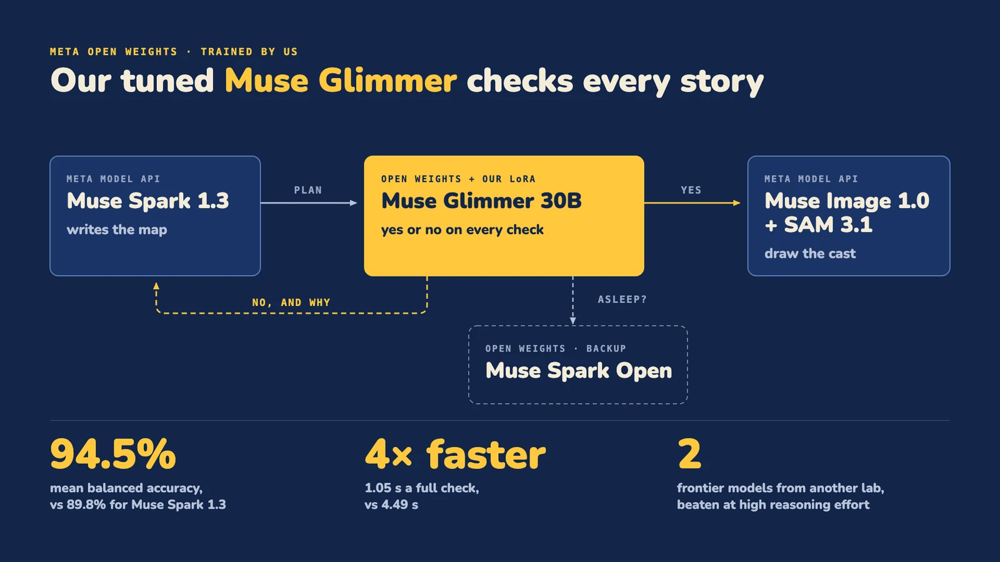
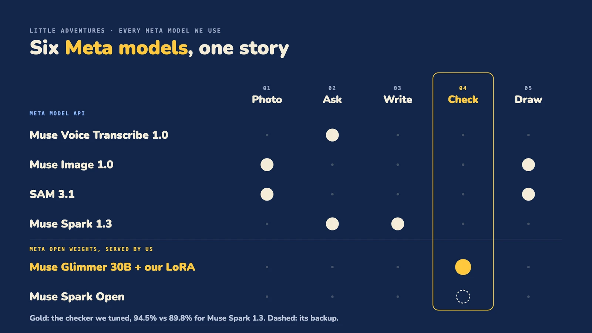
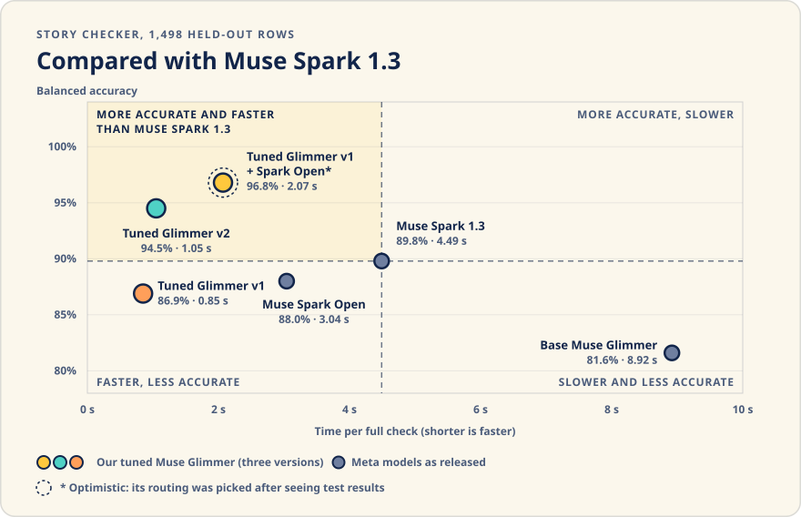
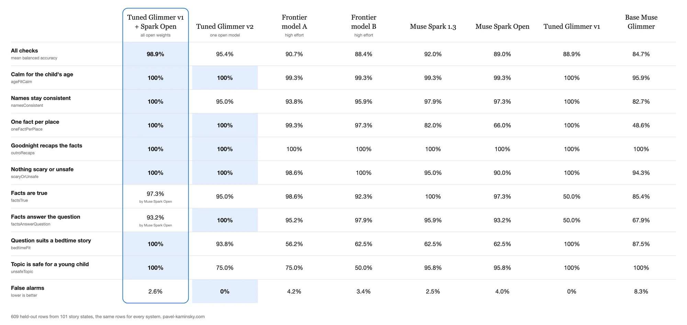

# The story checker: Muse Glimmer, tuned by us

<p align="center"></p>

Every story a child hears passes a set of yes/no checks first. We trained a LoRA on Muse Glimmer 30B, one of Meta's open-weight models, to answer them. On our held-out set it is more accurate than Muse Spark 1.3 and about four times faster.

- **Model card on Hugging Face: [kaminskypavel/glimmer-decision-little-adventures](https://huggingface.co/kaminskypavel/glimmer-decision-little-adventures)** (access on request)
- Per-row results and the offline replay: [benchmarks/checker](benchmarks/checker)

## Where the checker sits

<p align="center"></p>

Six Meta models make one adventure. The tuned Glimmer answers the story checks. Muse Spark Open answers them instead while the Glimmer GPU wakes.

## What it checks

Nine yes/no checks. Seven run on the story plan: calm for the child's age, names stay consistent, one fact per place, the goodnight recaps the facts, nothing scary or unsafe, the facts are true, the facts answer the question. Two run on the child's question before any plan exists: it suits a bedtime story, and the topic is safe for a young child. The check ids and the per-check results are in [benchmarks/checker](benchmarks/checker#what-the-checker-decides).

## How we trained it

- **Data.** Synthetic story plans and questions, written by Muse Spark 1.3 and Muse Spark Open. No data from real children.
- **Labels.** Each label comes from how its row was built: a clean plan passes, and a copy broken in one named way (one false fact, one wrong name, a missing recap) fails the check that the break targets. No label is a model's opinion.
- **Adapter.** LoRA rank 16, alpha 32, bf16 on the unquantized base. Only the language model's attention and MLP projections. One epoch, with the loss on the reply only.
- **Two adapters.** v1 covers the seven checks and hands the two fact checks to Muse Spark Open. v2 answers all nine on its own.
- **Held out.** 1,498 rows the tuned models never saw: 204 plans with 7 checks each, and 35 questions with 2 checks each.

## How the app uses it

- **One answer token.** The chat template fills in the start of the answer, so the first generated token is `yes` or `no`. P(yes) comes from that token's probability, and a check passes at 0.5. A failing answer adds one sentence of reason.
- **The client.** [packages/decision](packages/decision) talks to it through its `baseUrl` and `model` options. It is the same client that asks Muse Spark 1.3.
- **Serving.** One H100 on Modal that sleeps after 5 idle minutes. A check that finds it asleep wakes it and goes to Muse Spark Open on Baseten in the meantime. A daily cap bounds wake-ups.
- **The loop.** A failed check goes back to the writer, Muse Spark 1.3, with its reasons. After two failed rounds the engine stops, rather than give a child a weak story.

## Results

Mean balanced accuracy on all 1,498 held-out rows:

<p align="center"></p>

| Checker | Accuracy | Time per full check |
| --- | --- | --- |
| Tuned Glimmer v2 alone | 94.5% | 1.05 s |
| Muse Spark 1.3 | 89.8% | 4.49 s |
| Base Muse Glimmer | 81.6% | 8.92 s |
| Glimmer v1, with Muse Spark Open on the two fact checks | 96.8% | 2.07 s |

**Against frontier models.** We also ran two frontier models from another lab, at high reasoning effort, on 609 of the held-out rows (101 story plans never seen in training). The tuned Glimmer v2 beat both: 95.4% mean balanced accuracy with no false alarms, against 90.7% and 4.2% false alarms for the stronger of the two. Muse Spark 1.3 scored 92.0% on the same rows. The table from the model card, per check:

<p align="center"></p>

The same table, with every model named, is on the **[model card](https://huggingface.co/kaminskypavel/glimmer-decision-little-adventures#benchmarks)**.

**Paired test.** On the same 1,498 rows, Glimmer v2 is right where Muse Spark 1.3 is wrong 49 times, and the reverse happens 8 times (exact McNemar test, p = 2.7e-8).

## Caveats

- The hybrid's routing was picked after seeing test results, so its 96.8% is optimistic.
- The rows are not independent: the seven checks of one plan share that plan, and every plan is synthetic.
- P(yes) is not calibrated. Only the 0.5 threshold is used.
- Times are warm: the GPU was already awake.

## Replay it

```sh
bun run eval:checker   # recomputes every number above from the per-row results, offline, no key
```
