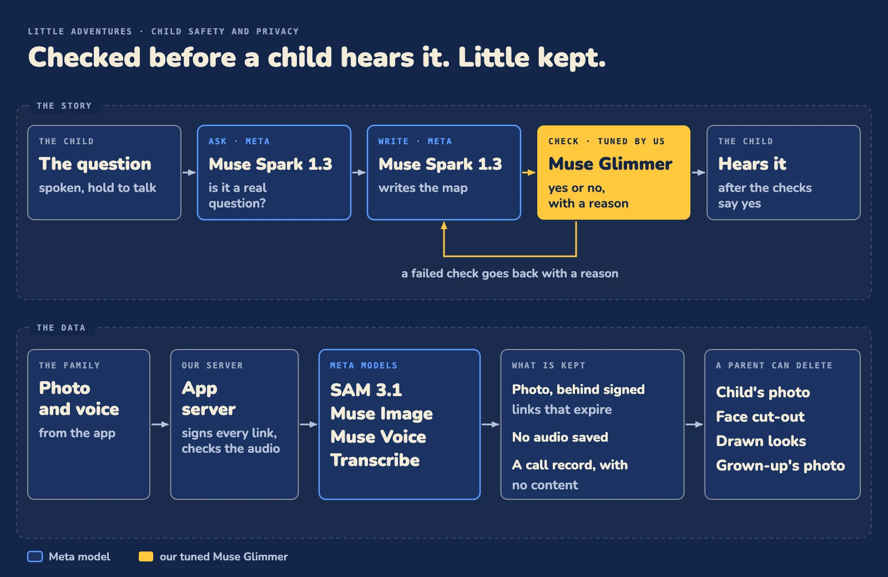

# Child safety and privacy

Every story passes checks before a child hears it. A child's photo and voice are handled so that little is kept, and a parent can delete the photos.

## The question

Muse Spark 1.3 first checks that what the child said is a real question. If not, the star asks again.

## The story checks

Muse Spark 1.3 writes the adventure as a map. Every story is checked before a child hears it, by our tuned Muse Glimmer ([how we trained it](training.md)), and a failed check goes back with a reason. The check ids and the per-check results are in [benchmarks/checker](../benchmarks/checker#what-the-checker-decides).

## The child's data

| What | How it is handled |
| --- | --- |
| The photo | The app uploads it straight to an S3-compatible bucket with a one-shot signed link (10 minutes, size capped). The server picks the key, under the grown-up's own prefix, and refuses any key that is not theirs. Reads use signed links that expire after 1 hour. See [packages/storage](../packages/storage) and [packages/api/src/routers/photo.ts](../packages/api/src/routers/photo.ts). |
| Which Meta calls see it | SAM 3.1 and Muse Image get a signed link to the photo, and to the drawn looks ([packages/api/src/art.ts](../packages/api/src/art.ts)). Muse Image and Muse Voice Transcribe calls carry an opaque safety id (a hash of the account id), never an email. |
| The spoken question | The child holds to talk. The phone records a 16 kHz mono WAV of up to 30 seconds (iPhone and Android) and sends it to the server, which checks it and passes it to Muse Voice Transcribe. The server writes no audio to the bucket or the database ([voice.ts](../packages/api/src/routers/voice.ts)). The only record of a model call is a row with model, operation, time, cost and result (the error text when it failed), with no content (`ai_calls` in [packages/db](../packages/db)). The text of the question goes on to the Kodio engine to make the adventure, with the language the grown-up chose (English, Spanish or Hebrew). The transcription call itself carries no language. |
| No data-sharing tier | The three Meta model ids in this repo (`sam-3.1`, `muse-image-1.0`, `muse-voice-transcribe-1.0`) are standard ids. None is a `-contributor` id, the tier that shares data. |
| Deleting | A parent can delete a child's photo, face cut-out and drawn looks, and the grown-up's photo and profile (`photo.delete`, `grownUp.delete`). Deleting a child's profile (`child.delete`, a red button at the end of the child's edit page, then a confirm) hides the child and its past adventures, and no new adventure can be made for that child. It is a soft delete: the rows, files and model-call rows are kept. |
| Casting to a TV | The TV gets signed links to the place's video and its subtitles, and to a picture of the map that the phone takes and uploads (up to 5 MB) through a signed link from the Kodio engine ([apps/native/src/cast](../apps/native/src/cast)). |
| Sign-in | Neon Auth, with a bearer token for the app. Every paid call is refused for an account that is not in the private beta, before any model is called ([packages/auth](../packages/auth), [packages/api/src/index.ts](../packages/api/src/index.ts)). An account is in the beta by being on the beta email list or by having joined it. An empty email list lets nobody in. A shared guest account, from "Try as a guest" on Welcome, signs in through the server, which keeps its password. The guest can play the finished adventures and ask a question. Making an adventure or changing a child shows "You need your own account", and the server refuses every write to children, photos or the grown-up for it. |

This repo cannot show what the Kodio engine does with the question text. The no-data-sharing statement covers the model ids in this repo only.

## What is not done yet

Erasing a child's data on request, or the sign-in account with its model-call rows, is not built yet. Deleting a child's profile hides it and keeps the data. See [Impact, limits and what's next](impact.md).
