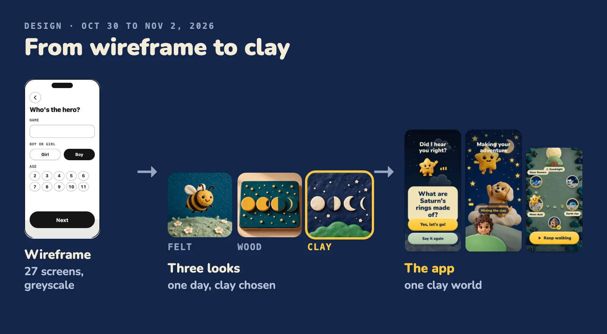

# Design: from wireframe to clay

We drew the structure first, tried three looks in one day, and picked clay. Then one clay world went onto every screen, and the last day went on polish.

## The steps

| Step | Date | What happened |
| --- | --- | --- |
| Wireframe | Oct 30 | 27 upright screens, approved. Structure only, greyscale on purpose, so nobody judged colours before the flow worked. |
| Design rounds | Oct 30 | The same screens in three material directions: felt, wood and clay. We compared them side by side and chose clay. |
| One clay world | Oct 30 to Nov 2 | The chosen look on every screen, built as our own design system. |
| Last polish | Nov 4 | A gear opens Grown-ups from Home and the map, Sign out is a red pill in the top corner, a deeper red so labels on red buttons stay readable, a restart icon and a home icon at the end, Who's listening shows a pencil on each face, Your plan opens on a tap, and Welcome offers Try as a guest. |

Every adventure is one map: an intro, four places and a goodnight. The wireframe fixed that shape before any look existed.

## What the clay world is made of

- **Design system.** [packages/native-ui](../packages/native-ui) holds the colours, type scale, sizes and motion timings in [tokens.ts](../packages/native-ui/src/tokens.ts), and the pieces built on them: clay buttons ([clay-pressable.tsx](../packages/native-ui/src/clay-pressable.tsx), [clay-surface.tsx](../packages/native-ui/src/clay-surface.tsx)), cards, chips, a bottom sheet over a dim scrim ([bottom-sheet.tsx](../packages/native-ui/src/bottom-sheet.tsx)) and the adventure map ([fork-map.tsx](../packages/native-ui/src/fork-map.tsx)).
- **The sky.** An animated night sky sits behind every screen ([sky.tsx](../packages/native-ui/src/sky.tsx)).
- **The star and the puppy.** Two companions that bob in place ([hop.tsx](../packages/native-ui/src/hop.tsx), [kit-star.tsx](../packages/native-ui/src/kit-star.tsx)).
- **The child as the hero.** The child is drawn in the same clay style as everything else, so the hero looks like it belongs in the world. See [Child safety and privacy](child-safety.md) for what happens to the photo.
- **Three languages.** Every screen's words sit in [src/i18n](../apps/native/src/i18n) in English, Spanish and Hebrew, picked in Grown-ups. Hebrew text reads right to left, and [plan-card.tsx](../packages/native-ui/src/plan-card.tsx) mirrors for it.
- **Two passes on every screen.** One for motion (timings, easing, what moves and what stays still) and one for colour.

## Rules for a child, and where they are in the code

| Rule | Where |
| --- | --- |
| Large tap targets: 64 pt at least, 88 pt for the main action. | `minTarget` and `primaryHeight` in [tokens.ts](../packages/native-ui/src/tokens.ts), used by [icon-button.tsx](../packages/native-ui/src/icon-button.tsx), [clay-pressable.tsx](../packages/native-ui/src/clay-pressable.tsx) and [kit-clay.tsx](../packages/native-ui/src/kit-clay.tsx) |
| Low light for bedtime: a deep navy night sky and dimmed cloud pictures. | `skyPalettes` in [tokens.ts](../packages/native-ui/src/tokens.ts), dimmed clouds in [sky-scene.ts](../packages/native-ui/src/sky-scene.ts) |
| Reduced motion is respected. The app reads the system setting once. With it on, the sky holds still and the star and puppy stop bobbing. | [motion-provider.tsx](../packages/native-ui/src/motion-provider.tsx), [sky.tsx](../packages/native-ui/src/sky.tsx), [hop.tsx](../packages/native-ui/src/hop.tsx) |
| Choices come with pictures, so a child who cannot read can steer. Each place on the map and each way to go shows its own picture, as a storybook photo on the night sky, and the star asks which way aloud. | [choice-photos.tsx](../apps/native/src/choice-photos.tsx), [fork-map.tsx](../packages/native-ui/src/fork-map.tsx) |

## What we tried and rejected

The look went through seven rounds in one day. Each round turned something down, and those no's became the rules above.

| Tried | What happened |
| --- | --- |
| Three invented concept "worlds", each with its own made-up art direction. | Rejected as generic. We restarted from what young children already know how to use: big cards, chunky rounded type, one hero per screen. |
| Felt, wood and clay on the same screens. | All three were good and all three were busy. We cut ornament, then chose clay. |
| Pink and purple. | Gone from the interface, the art and the sky. |
| Flat buttons and flat fields to calm a screen. | Rejected. Anything you can tap has the same raised clay depth, and flat means "not tappable". To calm a screen we cut elements instead. |
| A spinner while the adventure is made. | Never. The wait shows the star and the puppy playing, with facts and a progress bar that creeps, then speeds up when the story is ready. There is no spinner in the app code. |
| A speaker button on every choice. | Rejected twice. Pictures carry the meaning, and the star asks the question aloud. |
| A different mascot for each theme. | Dropped. One happy, wide-eyed star, never sleepy. |
| A looping video behind every screen. | Replaced by a sky drawn in code. |

The sky took six versions. A busy loop was too loud. A near-flat field made screens feel empty. Clouds made of clay looked like small balls, and soft wisps looked like fog. The one we kept has a dark gradient, puffy clouds that visibly drift and 34 twinkling stars. A drawn sky costs nothing to tune, so "darker" and "the top clouds are not moving" were quick fixes. It is now drawn with Skia, as one canvas for the whole scene ([sky.tsx](../packages/native-ui/src/sky.tsx)).

## Motion and accessibility

Between the screens of an adventure, a night-sky veil closes over the old screen in 400 ms, holds on the full sky for 120 ms, then opens on the new one in 450 ms ([screen-fade.tsx](../apps/native/src/screen-fade.tsx)). From a place to Pick a way the veil is a quick dip instead: 300 ms out, 350 ms in, no hold.

- **Sound follows the veil.** The music fades down as the sky closes, stays silent in the hold and comes back as it opens. The narration is let down too, and a place's first words rise over 500 ms.
- **Nothing plays under the veil.** A place waits until the sky is fully clear before it moves or speaks.
- **The child is never stuck.** Navigation runs from timers, not from animation callbacks, so a failed animation cannot hold a screen.
- **The full night gradient, not its darkest colour.** The darkest stop alone read as black.

Reduced motion changes this in two ways. The veil is skipped, so screens change at once and the music returns at once. The sky is frozen, not hidden: the scene opens in its first pose and stays there, and every star holds a steady opacity of 0.75. A child who needs less motion still sees the night sky.

For screen readers, 61 files in [apps/native](../apps/native) and [packages/native-ui](../packages/native-ui) set an `accessibilityLabel` (counted with `grep -rl accessibilityLabel` over the `.tsx` files). The child's question is read as one sentence, even though its words light up one at a time.

## Where the pictures come from

The finished screens are captures of the app.

More on how the app stays fast: [Performance](performance.md).
