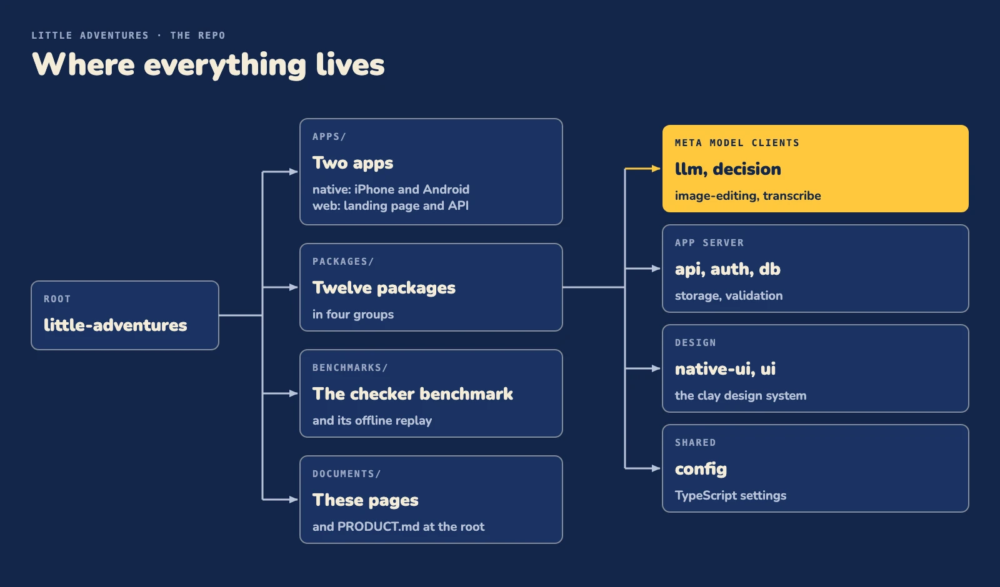

# Development

## Apps

| Path | What it is | Stack |
| --- | --- | --- |
| `apps/native` | The iPhone and Android app the child and parent use. English, Spanish and Hebrew in `src/i18n`, casting to a TV in `src/cast`. | Expo, React Native, Uniwind |
| `apps/web` | Public landing page and the tRPC API the app talks to. | Next.js, GSAP, tRPC |
| `packages/api` | tRPC routers: child and grown-up profiles, photo upload, voice transcription, the private beta check, waitlist. | tRPC, Zod |
| `packages/auth` | Sign-in, the app's bearer token and the private beta allowlist. | Neon Auth |
| `packages/llm` | Structured-output client for Muse Spark. | Zod |
| `packages/decision` | Yes or no question sets on Muse Spark, with a pass threshold. | Zod |
| `packages/image-editing` | SAM 3.1 person cut-out and Muse Image looks, edits and generation. | |
| `packages/transcribe` | Muse Voice Transcribe for the child's spoken question. | |
| `packages/storage` | Photos and drawn looks in an S3-compatible bucket, with signed URLs. | AWS SDK (S3) |
| `packages/validation` | Zod schemas the app and the server share (child, photo, sign-in). | Zod |
| `packages/db` | Database schema and client. | Drizzle, Postgres (Neon) |
| `packages/native-ui` | The app's clay design system: tokens, text, buttons, the map, the sky and a bottom sheet. | React Native, Reanimated |
| `packages/ui` | Shared web UI primitives. | shadcn/ui, Tailwind CSS |
| `packages/config` | Shared TypeScript config. | |

## Run it

Needs Node 24 (pinned in `.nvmrc`) and bun.

```bash
nvm use
bun install
bun run dev:web      # the app server (landing page and API) on http://localhost:3001
bun run dev:native   # Expo dev server for the iPhone and Android development builds
```

With no `.env` the app uses the production app server, and "Try as a guest" on Welcome needs no account ([Run it](../README.md#run-it)). To run your own app server, fill `apps/web/.env` (see [Configuration](#configuration)) with your own email in `BETA_EMAILS`, set `EXPO_PUBLIC_SERVER_URL=http://localhost:3001` in `apps/native/.env`, and keep `bun run dev:web` running. By default the app uses the production engine. To play the bundled sample adventure with no engine, set `EXPO_PUBLIC_ENGINE_URL=""` (quoted) in `apps/native/.env`. To use an engine, set the variable (see [Configuration](#configuration)) before `bun run dev:native`. Allowlisted accounts then get live adventures and every other account gets a recorded adventure.

To run the app on a device or simulator, run `bun run ios` from `apps/native` (needs Xcode) or `bun run android` (needs the Android SDK).

## Configuration

Each app declares its environment in `.env.schema`, and Varlock generates a typed `src/env.ts` on install (`bun run env:generate` after a schema change). Real values go in ignored `.env` files.

| Variable | App | Value |
| --- | --- | --- |
| `EXPO_PUBLIC_SERVER_URL` | `apps/native` | Base URL of the apps/web API. Defaults to the production app server, so a fresh clone runs with no `.env`; set `http://localhost:3001` to use your own |
| `EXPO_PUBLIC_ENGINE_URL` | `apps/native` | Base URL of the Kodio engine's player API. Defaults to the production engine. `EXPO_PUBLIC_ENGINE_URL=""` (quoted): the bundled sample adventure plays |
| `DATABASE_URL` | `apps/web` | Postgres connection string for profiles, the waitlist and model-call rows |
| `NEON_AUTH_BASE_URL` | `apps/web` | Base URL of the hosted sign-in |
| `NEON_AUTH_COOKIE_SECRET` | `apps/web` | Signs the session cookie (at least 32 characters) |
| `NATIVE_APP_SCHEME` | `apps/web` | URL scheme the app opens after a social sign-in (`little-adventures`) |
| `BETA_EMAILS` | `apps/web` | Optional. Comma separated emails of the grown-ups in the private beta. Empty: nobody |
| `GUEST_PASSWORD` | `apps/web` | Optional. Password of the shared guest account. Unset: "Try as a guest" is off on your own app server |
| `META_API_KEY` | `apps/web` | Optional. Meta Model API key for the child's looks and the spoken question. Unset: no art, no voice |
| `R2_ACCOUNT_ID`, `R2_BUCKET`, `R2_ACCESS_KEY_ID`, `R2_SECRET_ACCESS_KEY`, `R2_PUBLIC_URL` | `apps/web` | Optional. S3-compatible photo storage: the first four together or none. `R2_PUBLIC_URL` unset keeps reads signed |

## Prompts

`llm` and `decision` ship no production prompts and no question sets. The only prompts in this repo are the avatar look prompts in `packages/image-editing/src/looks.ts`. `packages/llm` throws without instructions, and `packages/decision` throws when `createDecision` gets none. Each expects its caller to bring its own:

- `llm`: instructions, a prompt and a zod schema per call. It returns JSON validated against the schema.
- `decision`: the shared instructions (and optional note for attached images) when you create it, then a named question set per call, each question with its own instructions, plus a pass threshold and what to do when the API cannot be reached.
- `image-editing`: the image or images and the edit or generation request per call. Calls throw on failure; the caller decides what that means.
- `transcribe`: a WAV recording (16 kHz, mono).

The production prompts were written this week and are held by the Kodio engine. The engine runs on Kodio Ltd's proprietary technology, which predates the hackathon. It calls Meta's models through the public packages above, in the steps shown in [How Meta's models run inside the Kodio engine](how-it-works.md#how-metas-models-run-inside-the-kodio-engine); only its prompts and question sets stay private. [the architecture page](architecture.md) has the reasoning and the organizers' ruling.

## Scripts

| Command | Does |
| --- | --- |
| `bun run dev` | Start every app |
| `bun run dev:web` | Start the Next.js app |
| `bun run dev:native` | Start the Expo dev server |
| `bun run ios` / `bun run android` (in `apps/native`) | Build and run the app on iPhone or Android |
| `bun run build` | Build every app |
| `bun run check-types` | Type-check the whole repo |
| `bun run test` | Run every unit test suite |
| `bun run test:e2e` (in `apps/native`) | Smoke test of the first screens, Welcome to the email step (Playwright; CI runs it when the app changes) |
| `bun run db:generate` / `bun run db:migrate` / `bun run db:push` | Create and apply database migrations, or push the schema |
| `bun run env:generate` | Regenerate the typed `src/env.ts` files from the `.env.schema` files |
| `bun run eval:checker` | Recompute the checker benchmark numbers offline, no key ([benchmarks/checker](../benchmarks/checker)) |
| `bun run check` / `bun run fix` | Lint and format (Ultracite, Biome) |

A Husky pre-commit hook runs lint-staged with Ultracite on staged files.

## Project structure

<p align="center"></p>
