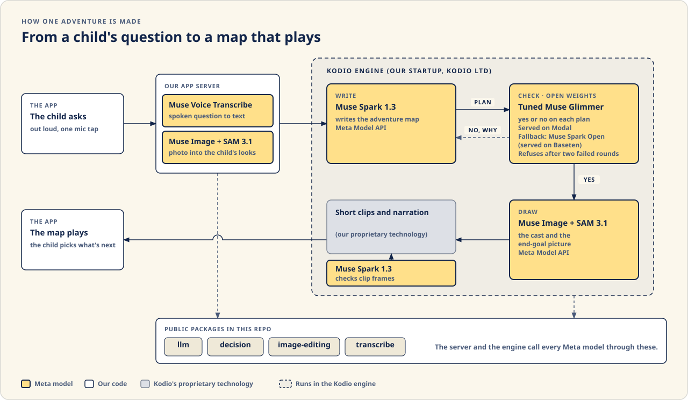
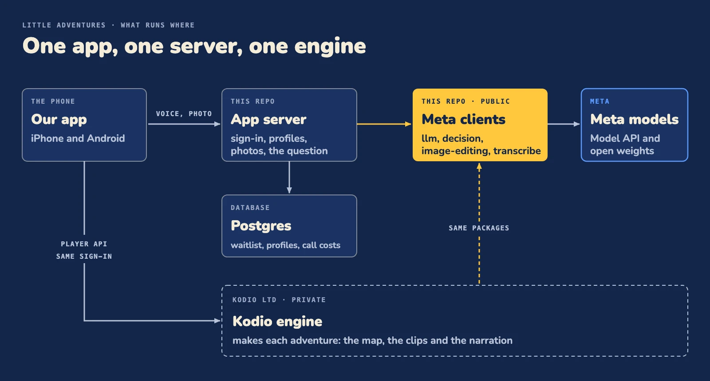

# How an adventure is made

## How Meta's models run inside the Kodio engine

The Kodio engine is our startup's private story technology (Kodio Ltd). It existed before the hackathon; this week we rebuilt its story steps on Meta's models. It reaches every Meta model through the public packages in this repo, so each kind of call it makes is in code you can read here. What stays private is its prompts and question sets.

One adventure, step by step:

1. **Hear the question.** Muse Spark 1.3 checks that the child asked a real question. It also shortens the question for the screen and writes the small facts the child sees while waiting (`llm`).
2. **Write the map.** Muse Spark 1.3 (`llm`, structured output) writes the adventure as a themed map: an end goal, four places with one true fact each that answers the question, and a goodnight that recaps them.
3. **Check.** Every story is checked before a child hears it. The checker is our LoRA on Muse Glimmer 30B, served on Modal; while its GPU wakes, Muse Spark Open on Baseten answers instead. A failed check goes back with a reason.
4. **Draw the cast.** Muse Image draws the cast and the end-goal picture; SAM 3.1 cuts the end-goal object out.
5. **Clips and voice.** The short clips and the narration are made inside the engine by our proprietary technology.
6. **Play.** The app polls the player API and plays each place as soon as it is ready. A place ends with a lesson card, its one true fact. Then the child picks the next place from photos. After the goodnight scene, "What we learned" sums up the four places. A place can also play on a TV.

Every model call is recorded with its model, operation, time and cost.

## How it fits together

This repo holds the app, the app server and the public packages that make every Meta model call (Muse Spark, Muse Image, SAM 3.1, Muse Voice Transcribe, and the Glimmer checker through `decision`). Its commit history is the real record of the week's work. The production prompts, the short clips and the narration live in the Kodio engine, which runs on Kodio Ltd's proprietary technology from before the hackathon. It reaches Meta's models through the public packages in this repo, in the steps shown in [How Meta's models run inside the Kodio engine](#how-metas-models-run-inside-the-kodio-engine). See [Architecture](architecture.md) for the split and why.

The child holds the button and asks. The phone records a 16 kHz mono WAV (on Android through a small local module, `apps/native/modules/wav-recorder`), and the app server turns it into text with `voice.transcribe`.

The Next.js app serves the landing page and a small tRPC API (waitlist, sign-in, child and grown-up profiles, photos, `voice.transcribe`). The Expo app talks to that API and, unless `EXPO_PUBLIC_ENGINE_URL` is set to empty, to the Kodio engine through its player API with the same sign-in token (every call is in `apps/native/src/data/engine-client.ts`). The app is multilingual. Every engine call that makes or shortens a story carries the language the grown-up picked, and reads of an adventure ask for it.

