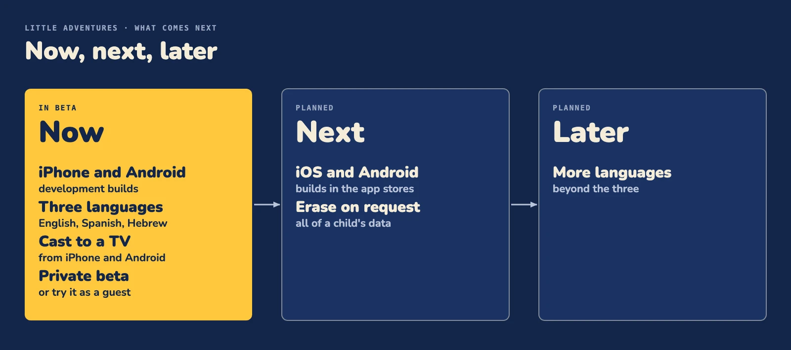

# Impact, limits and what's next

Little Adventures turns a child's own bedtime question into a calm, true story that stars the child. It is in a private beta, built by Kodio Ltd. Below: who it is for, its limits and what comes next.

## Who it is for

Children aged 2 to 16, with a parent beside them. The parent holds the phone in the evening, and the child asks a question out loud, such as "why do whales sing?" ([PRODUCT.md](../PRODUCT.md)).

What a parent gets:

- **The child's own question starts the story.** Hold the button and ask, no typing.
- **Calm.** No streaks, badges or timers. Every story is checked before the child hears it ([Child safety and privacy](child-safety.md)).
- **True facts.** Each place teaches one fact that answers the question, and ends with a lesson card. After the goodnight, "What we learned" sums the places up.
- **The child as the hero.** The story stars the child's own look, drawn from their photo.
- **Multilingual.** The grown-up picks the language in Grown-ups. The words on screen and the star's spoken question follow it, and Hebrew text reads right to left.
- **The big screen.** On iPhone and Android, a place can be cast to a TV that supports casting, with the story's words as subtitles. It needs the engine: the bundled sample adventure cannot be cast.
- **A parent in control.** The parent sets up the child, the likeness and the history, and can delete the photos.

## How each place teaches

Each place poses a question in a child's words, and its own fact answers it. A place with no question keeps its name, as older adventures do.

- **The question comes first.** On the map a place asks its question. On Pick a way each choice is labelled with the question of the place it leads to. When a place opens, the question shows in a balloon beside the star and is read aloud, and the words light up as they are said.
- **The answer comes after the visit.** Once a place is visited, its map label turns into the answer, so the map fills up with what the child found out.
- **A still card closes each place.** "What we learned" shows the place's fact with a Got it button. It has no voice and no animation.
- **A recap closes the adventure.** After the goodnight scene, one card lists every place's question with its answer, then a Goodnight button.

The point is that the child knows what the next minute is about, and sees at the end that the first question got answered ([place.tsx](../apps/native/app/place.tsx), [place-cards.tsx](../apps/native/src/place-cards.tsx)).

## The company

Kodio Ltd is a startup, and Little Adventures is its product. It was built by Pavel Kaminsky, a parent of two, because the best questions come at bedtime. The launch:

- The 45-second film: [YouTube](https://www.youtube.com/watch?v=ofxkeGxQeOU)
- The launch post: [on X](https://x.com/KaminskyPavel/status/2117210112993755191)

## Limits

- The short clips and narration are made in the Kodio engine by our proprietary technology, not by Meta models. With no engine (`EXPO_PUBLIC_ENGINE_URL=""` (quoted)), the app plays one bundled sample adventure.
- The app is multilingual. A story comes in the chosen language when the engine has a version of it.
- The iOS and Android builds are not in the stores yet; they run as development builds.
- The Glimmer LoRA numbers are the team's own, on synthetic data. The 96.8% hybrid is optimistic (see [training.md](training.md)).
- Deleting a child's profile hides it and its past adventures, and keeps the data. Erasing a child's data on request, or the account with its model-call rows, is not built yet.
- This repo does not show what the Kodio engine keeps from a child's question. The no-data-sharing statement in [Child safety and privacy](child-safety.md#the-childs-data) covers the ids in this repo only.

## What comes next

| When | What |
| --- | --- |
| Now | iPhone and Android development builds, multilingual, casting a story to a TV, a private beta |
| Next | iOS and Android store builds, erasing a child's data on request |
| Later | More languages |

Next and Later are plans, not shipped work.
