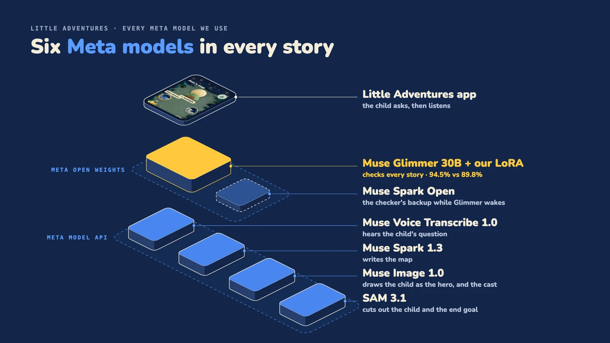

# Meta models

| Model | Job | Code | Runs |
| --- | --- | --- | --- |
| Muse Spark 1.3 | Structured output (`llm`) and yes/no checks (`decision`). The engine uses both to write and check the map. | [packages/llm](../packages/llm), [packages/decision](../packages/decision) | Meta Model API |
| Muse Image 1.0 | Draws the hero's looks from the child's photo, and the cast. | [packages/image-editing](../packages/image-editing) | Meta Model API |
| SAM 3.1 | Cuts the person out of a photo. | [packages/image-editing](../packages/image-editing) | Meta Model API |
| Muse Voice Transcribe 1.0 | Turns the child's spoken question into text. | [packages/transcribe](../packages/transcribe) | Meta Model API |
| Muse Glimmer 30B + our LoRA | The story checker. `decision` talks to it through its `baseUrl` and `model` options and reads yes/no probabilities from the logprobs of the first answer token. | [packages/decision](../packages/decision) | Served on Modal |
| Muse Spark Open | Fallback checker when the tuned model is asleep. | [packages/decision](../packages/decision) | Served on Baseten |

Not used: Muse Wonder, Muse Code.

How we trained the checker, and its results: [training.md](training.md).
