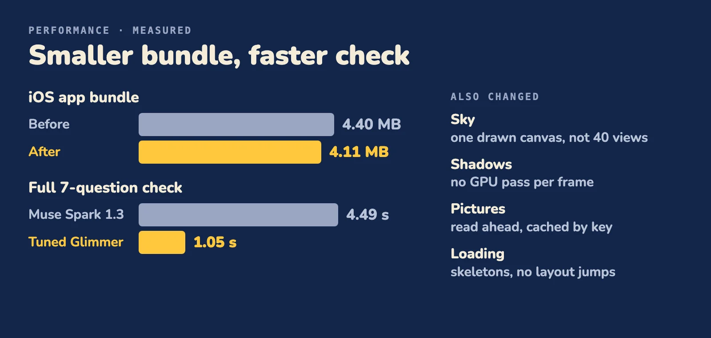

# Performance

The iOS bundle is 0.29 MB smaller and a full story check takes 1.05 s instead of 4.49 s. The app also does far less work per frame on a phone.

## Measured

| Measure | Before | After | Where |
| --- | --- | --- | --- |
| iOS JS bundle | 4.40 MB | 4.11 MB | [metro.config.cjs](../apps/native/metro.config.cjs) |
| Full 7-question story check | 4.49 s (Muse Spark 1.3) | 1.05 s (tuned Muse Glimmer) | [benchmarks/checker](../benchmarks/checker) |
| Home, idle, compositor load (Activity Monitor) | 46 to 49% | 27 to 33% | [sky.tsx](../packages/native-ui/src/sky.tsx) |
| Home, idle, app CPU | 42% | 24% | [sky.tsx](../packages/native-ui/src/sky.tsx) |
| Home frame rate on an iPhone 12, from the shadow changes | about 33 fps | about 58 fps in most seconds | [clay-surface.tsx](../packages/native-ui/src/clay-surface.tsx) |
| Meta model calls per live adventure | | about 51 calls, about $0.30 | every call is recorded with its model, time and cost |

The bundle figures are from the same `expo export`, before and after. The check time is the median of 20 full checks with the GPU already awake, as the benchmark's caveats say; it leaves out the wake-up. The phone figures are from one device, one build, back to back. The bundle and phone figures were taken before the language, casting and Android microphone work; the bundle has not been measured again.

## How we measured, and what did not work

We measured on a real iPhone 12, with Instruments (Animation Hitches and Activity Monitor), one change at a time, on the same screen. The simulator hides the cost: a Mac GPU absorbs the work, and it cannot record hitches at all. Three fixes we tried first did not work:

- **Rasterizing the twinkling stars.** Offscreen passes per frame only went from 238 to 202. A twinkle changes the layer every frame, so the cached bitmap is redrawn. Rasterizing helps only layers that stand still, which is why the clay shadows use it. The stars got a cheaper glow instead.
- **Easing alone for the sky.** Moving the endless loops to the platform animator cut app CPU from 33% to 27%, but the compositor stayed at 48%. It still moved dozens of large layers at 60 fps. Only drawing the sky as one canvas fixed that.
- **Expo's tree shaking for zod.** It kept all 95 zod modules. The Metro redirect below is what removed them.

The bundle is 4.4 MB of minified JavaScript, and most of it is the stack itself. The largest parts are react-native at 684 KB, react-native-reanimated at 645 KB, zod at 538 KB (before the redirect), expo-router at 502 KB, and our own screens at 385 KB plus our shared UI package at 194 KB.

## English-only validation messages

- **Slow.** The form validation library, zod, ships the error messages of about 60 languages. The app only uses zod's English ones (every screen carries its own words in English, Spanish and Hebrew), and Metro cannot drop the unused ones: about 300 KB.
- **Changed.** A Metro resolver redirect points zod's locale index at a file that exports English only ([metro.config.cjs](../apps/native/metro.config.cjs), [zod-locales.js](../apps/native/src/zod-locales.js)).
- **Result.** The iOS bundle went from 4.40 MB to 4.11 MB. zod in the bundle went from 538 KB in 95 modules to 243 KB in 32.

## A faster checker

- **Slow.** Checking a story with a general model takes 4.49 s for the 7 plan checks.
- **Changed.** We tuned Muse Glimmer 30B to answer the checks ([how](training.md)).
- **Result.** 1.05 s per full check. It is also more accurate on our held-out set. The per-row results can be replayed offline: [benchmarks/checker](../benchmarks/checker).

## Phone heat: the sky

- **Slow.** The idle screens looped about 40 animated views forever: drifting clouds, twinkling stars, the title letters, the star and puppy. Each frame committed the whole view tree and moved dozens of layers. The phone got warm sitting on Home.
- **Changed.** The sky is one Skia canvas, redrawn 30 times a second from the UI thread ([sky.tsx](../packages/native-ui/src/sky.tsx)). The endless bobs of the title letters, the star and the puppy use the platform's own animator ([hop.tsx](../packages/native-ui/src/hop.tsx), [logo.tsx](../packages/native-ui/src/logo.tsx)).
- **Result.** Compositor load on Home fell from 46 to 49% to 27 to 33%, and app CPU from 42% to 24%.

## iOS shadows

- **Slow.** On iOS, a CSS-style shadow costs the GPU extra passes. Home on an iPhone 12 paid about 238 per frame while it only sat there.
- **Changed.** The clay shadow layer is rasterized once and redrawn only while pressed ([clay-surface.tsx](../packages/native-ui/src/clay-surface.tsx)). The New adventure button morphs with transforms and a cross-fade, not animated width and height ([morph-pill.tsx](../packages/native-ui/src/morph-pill.tsx)). The star video casts no live shadow on iOS ([star-take.tsx](../packages/native-ui/src/star-take.tsx)).
- **Result.** Home went from about 33 to about 58 fps in most seconds on the device.

## Pictures: read ahead and cached

- **Slow.** Story pictures are signed links that change on every read. Reading them ahead by link missed the cache, so the map showed empty frames while pictures downloaded, and a picture could vanish after being freed too early.
- **Changed.** Pictures are read ahead through the image cache under a stable key, decoded small, and the returned reference is dropped, not released ([use-adventure.ts](../apps/native/src/data/use-adventure.ts), [engine-map.ts](../apps/native/src/data/engine-map.ts)). Views keep pictures in memory and on disk with a short fade ([fallback-image.tsx](../packages/native-ui/src/fallback-image.tsx)).
- **Result.** The map paints with its pictures when it opens. We did not time this one.

## Between clips and on the UI thread

- **Slow.** A new native video view is slow to come up on an iPhone, and re-stacking video views makes it worse. A style that animates on the UI thread cannot call a JavaScript function.
- **Changed.** A place keeps two video layers in a fixed order and only the top one fades, so no video view is re-stacked ([place.tsx](../apps/native/app/place.tsx), [parts.ts](../apps/native/src/data/parts.ts)). The tilt of each pick-a-way photo is worked out once on the JavaScript side and handed to the animated style ([choice-photos.tsx](../apps/native/src/choice-photos.tsx)).
- **Result.** We did not time these.

## No layout jumps

- **Slow.** Content that arrives late can push everything around it.
- **Changed.** Loading regions show a flat skeleton with the size of the real thing ([skeleton.tsx](../packages/native-ui/src/skeleton.tsx), [idea-picture.tsx](../packages/native-ui/src/idea-picture.tsx)). It stands still under reduced motion.
- **Result.** Nothing moves when the content arrives. We did not time this one.

More on the look of the app: [Design](design.md).
