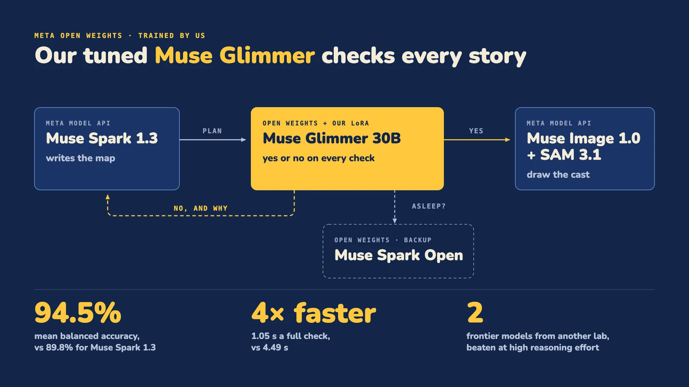
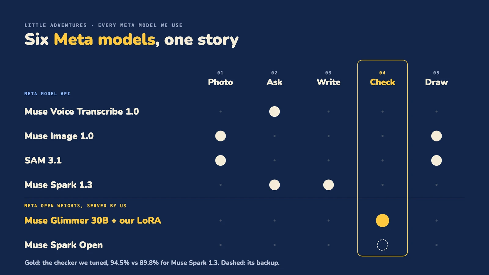
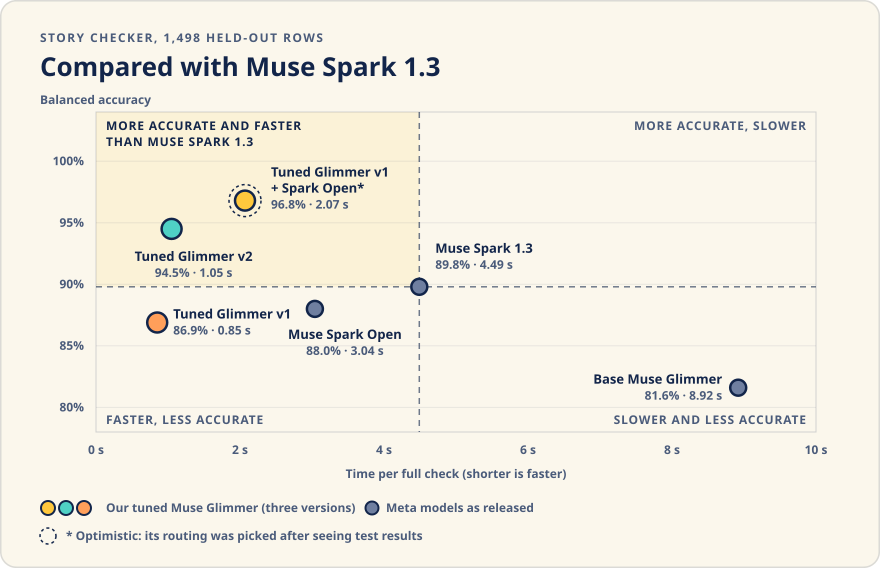
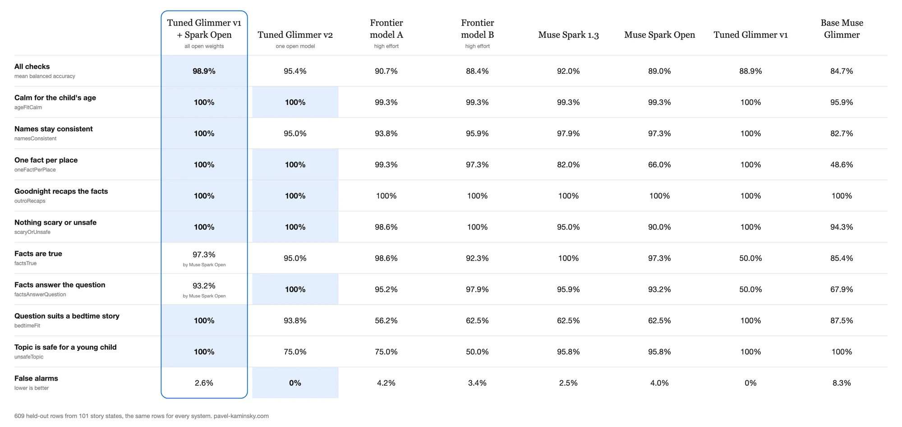

# The story checker: Muse Glimmer, tuned by us

<p align="center"></p>

Every story a child hears passes a set of yes/no checks first. We trained a LoRA on Muse Glimmer 30B, one of Meta's open-weight models, to answer them. On our held-out set the tuned model alone (v2) scores 94.5% mean balanced accuracy over all nine checks, against 89.8% for Muse Spark 1.3, and 98.9% against 96.1% on the seven story-plan checks. A full check takes 1.05 s against 4.49 s.

- **Model card on Hugging Face: [kaminskypavel/glimmer-decision-little-adventures](https://huggingface.co/kaminskypavel/glimmer-decision-little-adventures)** (access on request)
- Per-row results and the offline replay: [benchmarks/checker](../benchmarks/checker)

## Where the checker sits

<p align="center"></p>

Six Meta models make one adventure. The tuned Glimmer answers the story checks. Muse Spark Open answers them instead while the Glimmer GPU wakes.

## What it checks

Nine yes/no checks. Seven run on the story plan, on safety, facts and consistency. Two are on the child's question, on whether it suits a bedtime story and is safe; they are in the benchmark, and the live engine does not run them yet. The check ids and the per-check results are in [benchmarks/checker](../benchmarks/checker#what-the-checker-decides).

## How we trained it

- **Data.** Synthetic story plans and questions, written by Muse Spark 1.3 and Muse Spark Open. No data from real children.
- **Labels.** Each label comes from how its row was built: a clean plan passes, and a copy broken in one named way (one false fact, one wrong name, a missing recap) fails the check that the break targets. No plan label is a model's opinion; for v2, Muse Spark 1.3 picked out questions it judged to be in the wrong category, and they were dropped.
- **Adapter.** A LoRA on the unquantized base, one epoch, with the loss on the reply only.
- **Two adapters.** v1 covers the seven checks and hands the two fact checks to Muse Spark Open. v2 answers all nine on its own.
- **Held out.** 1,498 rows the tuned models never saw: 204 plans with 7 checks each, and 35 questions with 2 checks each.

## How it got here

- **v1 failed on facts.** It scored 100% on five of the seven plan checks. On both fact checks it scored 50.0% balanced accuracy, a coin flip: it said yes to every row. Training had too few failing rows for those two checks.
- **v2 added more fact copies.** Plans with one false fact, and plans with a true fact the child did not ask about, so both fact checks had many more failing rows to learn from. The recipe stayed the same.
- **That fixed both fact checks.** "Facts are true" went from 50.0% to 93.5%, and "Facts answer the question" from 50.0% to 100%.
- **The two question checks got worse.** "Suits a bedtime story" fell from 93.2% to 86.4%, and "topic is safe" from 88.9% to 72.2%.
- **A likely cause.** v2 also dropped those questions, from training and from the test set. Fewer unsafe questions were left to learn from. The test has only 31 failing question rows, so each miss moves the score a lot. We did not test this cause.
- **What we kept.** v2 is the one we serve, as it is better overall. The hybrid in the results table pairs the v1 adapter with Muse Spark Open on the two fact checks.

## How the app uses it

- **One answer token.** The chat template fills in the start of the answer, so the first generated token is `yes` or `no`. P(yes) comes from that token's probability, and a check passes at 0.5. A failing answer adds one sentence of reason.
- **The client.** [packages/decision](../packages/decision) talks to it through its `baseUrl` and `model` options. It is the same client that asks Muse Spark 1.3.
- **Serving.** One GPU on Modal that sleeps when idle. A check that finds it asleep wakes it and goes to Muse Spark Open on Baseten in the meantime.
- **The loop.** Every story is checked before a child hears it; a failed check goes back with a reason.

## Results

Mean balanced accuracy on the held-out set: all nine checks (1,498 rows) and the seven story-plan checks (1,428 rows).

<p align="center"></p>

| Checker | All nine checks | Seven story-plan checks | Time per full check |
| --- | --- | --- | --- |
| **Tuned Glimmer v2 alone** | **94.5%** | **98.9%** | **1.05 s** |
| Muse Spark 1.3 | 89.8% | 96.1% | 4.49 s |
| Base Muse Glimmer | 81.6% | 80.3% | 8.92 s |
| Glimmer v1, with Muse Spark Open on the two fact checks | 96.8% | 98.5% | 2.07 s |

The last row is a hybrid whose routing was picked after seeing these results, so treat it as optimistic. The tuned model alone is the one we lead with.

**Where it is weaker.** v2 is ahead of Muse Spark 1.3 on five checks, level on one and behind on three: names stay consistent (98.5% against 98.8%), the facts are true (93.5% against 99.4%) and the topic is safe for a young child (72.2% against 75.9%). Both models find that topic check hard. The per-check numbers for every system are in [benchmarks/checker](../benchmarks/checker#output).

**Against frontier models.** We also ran two frontier models from another lab, at high reasoning effort, on 609 of the held-out rows (101 story plans never seen in training). The tuned Glimmer v2 alone beat both: 95.4% mean balanced accuracy with no false alarms, against 90.7% (4.2% false alarms) and 88.4%. Muse Spark 1.3 scored 92.0% on the same rows. This set is smaller than the 1,498 rows above, so its numbers differ from the chart. The table from the **[model card](https://huggingface.co/kaminskypavel/glimmer-decision-little-adventures#benchmarks)**, per check; its boxed column is the optimistic hybrid:

<p align="center"></p>

**Paired test.** On the same 1,498 rows, Glimmer v2 is right where Muse Spark 1.3 is wrong 49 times, and the reverse happens 8 times (exact McNemar test, p = 2.7e-8).

## Caveats

- The hybrid's routing was picked after seeing test results, so its 96.8% (98.9% on the 609-row slice) is optimistic.
- The rows are not independent: the seven checks of one plan share that plan, and every plan is synthetic.
- P(yes) is not calibrated. Only the 0.5 threshold is used.
- Times are warm: the GPU was already awake.
- Muse Spark models wrote the test plans and questions. That may tilt the results toward Muse Spark.
- Nobody has hand-checked the labels. Each comes from how its row was built, and no person has read a sample.

## Replay it

```sh
bun run eval:checker   # recomputes every number above from the per-row results, offline, no key
```
